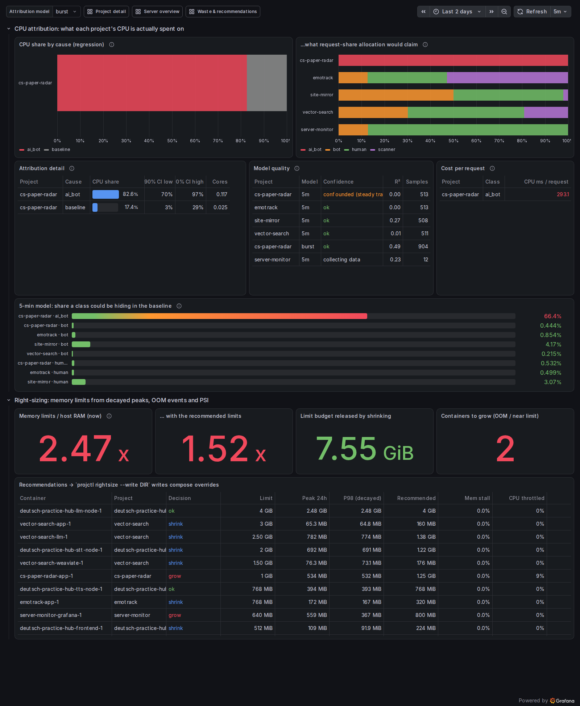

# ServerMonitoring

**Resource accountability for small multi-project Docker hosts.** Prometheus + Grafana, plus three
analyses that standard exporters don't provide:

1. **Who is the CPU spent on?** Regression-based attribution of each project's CPU to *baseline*
   (background work), *humans*, *AI crawlers*, *other bots* and *scanners*. It reports bootstrap
   intervals and an **identifiability check**, and uses **1 Hz burst sampling** for steady,
   rate-limited crawlers that minute-level data cannot separate from background work.
2. **What should the memory limits be?** VPA-style right-sizing for **Docker Compose**: decayed
   quantiles, OOM bump, a **PSI (pressure stall) guard**, and a host-level *limit overcommit* ratio.
   The output is a reviewable compose override.
3. **Which projects are idle?** Evidence-based park candidates (no engaged visitor, commit, edit,
   build or test run), and `projctl park/unpark` to stop and restore a project's stack, units and
   timers exactly.

Runtime: the Python standard library only (no numpy), from systemd timers, next to a hardened
Compose stack (Prometheus, Grafana, cAdvisor, node-exporter, blackbox). Built for and validated on
a 4 vCPU / 8 GB VPS running nine projects.



## Why

On small servers the obvious numbers mislead:

- *"AI crawlers sent 99 % of the requests, so they cost 99 % of the CPU."* Request-share allocation
  ignores background load and per-request cost. On the reference host, regression shows one site's
  CPU is **~100 % background** (a demo loop: the CPU stays flat whatever the traffic). Another
  site's CPU really is **~80 % crawler-driven, ~290 ms per page**, which 5-minute monitoring
  cannot see because the crawler's rate never changes.
- *"Limits are set, so the host is protected."* The container memory limits added up to **2.5× the
  RAM**. Several services had 10–40× more limit than they ever used, while one app was OOM-killed by
  a spike its 5-minute peaks never showed.

## Results (see [docs/evaluation.md](docs/evaluation.md))

| Experiment | Request-share allocation | Idle floor + request share | **This (regression)** |
|---|---|---|---|
| 5-min model, semi-synthetic: real CPU + real crawler traffic + injected costs (36 scenarios), mean abs. error of shares | 45.8 % | 5.5 % | **0.7 %** |
| Burst model, semi-synthetic: real background + injected costs on real 1 Hz arrivals, short and long CPU tails (10 scenarios), mean abs. error | 83.2 % | – | **3.6 %** (60 s bins: 16.8 %) |
| Real site, steady rate-limited crawler: request-driven share (per-thread accounting: ≥ 95 %) | 100 % | – | **82 %** (90 % CI 69–97 %); 5-min model correctly flags `confounded` |

The detection limit is stated, not hidden: at 0.4 req/s, a crawler class becomes significant in the
5-minute model at about 50 ms of CPU per request. Below that, or when traffic is rate-limited to a
constant, the burst model is needed. The evaluation also records a failed first design of the burst
estimator.

Tests: 135 unit tests, plus promtool rule tests and a CI Compose smoke test. The NNLS solver is
checked against brute force and the KKT conditions, attribution recovery and interval coverage on
synthetic data, every right-sizing rule, the traffic classifier, an end-to-end analyzer run against
a fake Prometheus, and dashboard validity. All tests run on every push.

## Quick start

```bash
git clone https://github.com/ifatwme/ServerMonitoring.git /opt/server-monitor && cd /opt/server-monitor
cp .env.example .env && sed -i "s/^GF_ADMIN_PASSWORD=.*/GF_ADMIN_PASSWORD=$(openssl rand -hex 16)/" .env
cp config/projects.example.toml config/projects.toml      # one block per compose project
sudo scripts/install-systemd.sh                          # stack + collector/analyzer/burst timers
ssh -L 3000:127.0.0.1:3000 <your-server>                 # Grafana on http://localhost:3000
```

Requirements: Linux with cgroup v2 + PSI, Docker Compose v2, Python ≥ 3.11 on the host, nginx
`combined` access logs for the traffic analysis. An optional public TLS front for Grafana behind an
SNI router is in `deploy/compose.public.yml`.

## `projctl`

```text
projctl ls                      state, CPU, RAM, disk, visitors, bot load, idle days per project
projctl insights [project]      CPU attribution (burst + 5-min models) vs. request share
projctl rightsize [project] [--write DIR]   limit recommendations (+ compose override files)
projctl whatif <project>...     RAM/CPU freed and host headroom if parked
projctl suggest                 park candidates, degraded projects, reclaimable disk
projctl park|unpark <project> -y
projctl cleanup [-y]            build cache + images no compose file needs (dry-run by default)
```

Real output from the reference host:

```text
$ projctl insights cs-paper-radar
cs-paper-radar  (mean 0.142 cores)
  burst model, 1 Hz: 8 bursts / 904 s, lags -1..1 s, baseline from quiet-seconds, confidence ok
    cause      CPU share      90% CI by requests  cost/request
    baseline       17.4%      3%-29%           -             -
    ai_bot         82.6%     70%-97%      100.0%        293 ms
  5-minute model: 513 samples, R2 0.00, hold-out 0.00, confidence confounded
    cause      CPU share      90% CI by requests  cost/request
    baseline      100.0%    89%-100%           -             -
    ai_bot          0.0%      0%-11%      100.0%             -
    bot             0.0%       0%-0%        0.0%             -
    human           0.0%       0%-0%        0.0%             -
    ! ai_bot traffic is too steady for 5-minute data: it could be up to 66% of the CPU
```

## Dashboards

| | |
|---|---|
| **Server overview** | host gauges, CPU/RAM stacked by project, PSI, projects table (uptime, idle, park status, TLS days), firing alerts, uptime timeline |
| **Project detail** | containers (incl. stopped), jobs, activity signals, CPU/RAM per service vs. limits, PSI, traffic by class, top user agents, images |
| **Waste & recommendations** | park candidates, CPU per real visitor, heavy-but-quiet containers, traffic mix, unused images, disk trend |
| **Insights** | attribution (burst / 5-min) vs. request share, intervals, model quality, identifiability, right-sizing table, overcommit |

Dashboards are generated from code (`grafana/build_dashboards.py`); CI fails if the committed JSON
is stale.

## Documentation

- [docs/research.md](docs/research.md): problem, prior art (R-Capriccio, VPA/KRR, Kepler, Sablier, …), contributions, limitations, references
- [docs/attribution.md](docs/attribution.md): the NNLS model, bootstrap, identifiability, burst sampling
- [docs/rightsizing.md](docs/rightsizing.md): the memory/CPU recommender and how it differs from VPA/KRR
- [docs/evaluation.md](docs/evaluation.md): benchmarks, the steady-crawler case study, reproduction commands
- [docs/architecture.md](docs/architecture.md): components, install, configuration, security, footprint, metrics reference

## Layout

```
src/servermon/      collector, traffic, attribution, burst, nnls, rightsizing, analyze, projctl (stdlib only)
bin/                entry points used by systemd (sm-collect, sm-burst, sm-analyze, projctl)
prometheus/         scrape config, recording + alert rules
grafana/            provisioning, dashboards-as-code, generated dashboards
deploy/             systemd unit templates, optional public front (compose.public.yml, nginx)
experiments/        reproducible validation (semi-synthetic benchmark, burst validation + trace)
tests/              pytest suite, promtool rule tests
```

MIT licensed.
