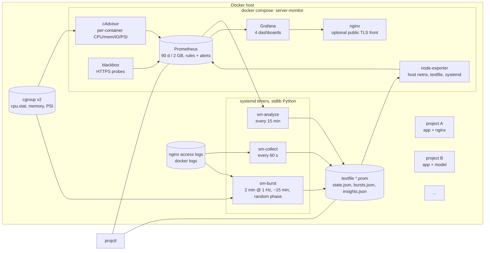

# Architecture and operations

## Components



| Piece | Role |
|---|---|
| `src/servermon/collector.py` | container state (incl. **stopped** containers), health, restarts, OOM, limits; traffic per class; activity signals; unit results; disk per project; apt / reboot / SSH failures. Writes `server_monitor.prom` and the blackbox targets (`file_sd`). |
| `src/servermon/burst.py` | 1 Hz cgroup sampler + per-second arrivals → normal equations per burst. |
| `src/servermon/analyze.py` | 5-minute attribution, burst attribution, right-sizing → `server_monitor_insights.prom`, `insights.json`. |
| `src/servermon/projctl.py` | CLI: `ls`, `suggest`, `insights`, `rightsize`, `whatif`, `park`, `unpark`, `cleanup`. |
| `prometheus/rules/server.yml` | recording rules (per-project/service CPU, memory, network, I/O, uptime) and 18 alerts. |
| `grafana/build_dashboards.py` | dashboards as code → `grafana/dashboards/*.json` (provisioned read-only). |

## Install

Requirements: Linux with cgroup v2 and PSI (kernel ≥ 4.20), Docker + Compose v2, Python ≥ 3.11 on the host.

```bash
git clone https://github.com/ifatwme/ServerMonitoring.git /opt/server-monitor && cd /opt/server-monitor
cp .env.example .env && sed -i "s/^GF_ADMIN_PASSWORD=.*/GF_ADMIN_PASSWORD=$(openssl rand -hex 16)/" .env
cp config/projects.example.toml config/projects.toml     # describe your projects
sudo scripts/install-systemd.sh            # renders @INSTALL_DIR@ into the units, enables stack + timers
```

## Configure projects (`config/projects.toml`)

```toml
[settings]
idle_days = 7                       # park candidate after this many idle days
keep_images = ["goacme/lego"]       # never removed by `projctl cleanup`

[projects.my-app]                   # = the compose project name (com.docker.compose.project)
kind = "app"                        # app | batch | infra (infra is never parked)
dir = "/srv/my-app"                 # the repo: commits, uncommitted edits, compose file
dev_dirs = ["/srv/my-app-dev"]      # edits here count as development activity
unit = "my-app.service"             # what `projctl park` disables
timers = ["my-app-backup.timer"]    # stopped while parked
url = "https://my-app.example.org/" # blackbox uptime + TLS expiry
web_container = "my-app-web-1"      # nginx whose access log is the traffic source
images = ["my-app"]                 # image prefixes for disk accounting
```

The access-log parser expects nginx's `combined` format (optionally followed by more quoted fields).

## Reach Grafana

- **Private (default):** Grafana listens on `127.0.0.1:3000`; use `ssh -L 3000:127.0.0.1:3000 <host>`.
- **Public (optional):** `deploy/compose.public.yml` adds an `nginxinc/nginx-unprivileged` TLS front
  for an SNI/PROXY-protocol edge router (`listen 8444 ssl proxy_protocol`, published on 127.0.0.1
  only), login rate limiting (6/min per IP), secure cookies and no indexing. Prometheus and the
  exporters stay private. Certificates: `scripts/renew_cert.sh` (lego HTTP-01, ZeroSSL/Let's Encrypt)
  + `server-monitor-cert-renew.timer`. Enable it with
  `COMPOSE_FILE=docker-compose.yml:deploy/compose.public.yml` in `.env`.

## Security notes

- Every container: `no-new-privileges`, `cap_drop: [ALL]`, read-only root filesystem where possible,
  memory/CPU/PID limits, log rotation.
- node-exporter runs in the host network namespace but binds only to the monitor bridge gateway
  (`MONITOR_GATEWAY`), so it is reachable from Prometheus and not from the internet. It needs
  `apparmor:unconfined` because Docker's default profile blocks D-Bus (systemd collector).
- cAdvisor gets only `SYSLOG` (for `/dev/kmsg` OOM events) and `DAC_READ_SEARCH`.
- No secrets in the repository: `.env` and `config/projects.toml` are git-ignored, and systemd units
  are templates (`@INSTALL_DIR@`). `scripts/push.sh` refuses to push if any commit contains key
  material, a tracked local-only file, or a line from your private `.push-denylist`
  (server IP, domains, host paths).

## Footprint (reference host: 4 vCPU, 8 GB, no swap)

| | RAM (typical) | CPU (24 h mean) |
|---|---|---|
| Prometheus (≈ 6 k series) | 90–130 MB | 0.01 |
| Grafana | 260–450 MB | 0.01 |
| cAdvisor (`disk` metrics off) | 35 MB | 0.02 |
| node-exporter, blackbox | 25 MB each | < 0.01 |
| collector / analyzer / burst (systemd) | 20–35 MB while running | ≈ 0.03 |

cAdvisor's `disk` collector is disabled on purpose: it runs `du` over every container root
filesystem (5–15 s each). The collector measures disk per project instead, every 10 minutes.

## Metrics reference (`sm_*`)

| family | labels | meaning |
|---|---|---|
| `sm_container_up`, `_healthy`, `_restart_count`, `_oom_killed`, `_exit_code`, `_memory_limit_bytes`, `_cpu_limit_cores` | project, service, container | container state, including stopped containers |
| `sm_http_requests_total` (counter), `sm_http_requests_window`, `sm_http_unique_clients_window`, `sm_http_agent_requests_24h` | project, class, code / window / agent | traffic per class |
| `sm_project_last_activity_timestamp_seconds` | project, signal | commit / edit / build / container_start / human_visit |
| `sm_project_idle_seconds`, `_park_candidate`, `_parked`, `_containers`, `_disk_bytes` | project | idle detection and footprint |
| `sm_unit_last_success`, `_last_duration_seconds`, `sm_timer_enabled` | project, unit | systemd jobs |
| `sm_docker_image_bytes`, `sm_docker_reclaimable_bytes` | image, project, in_use / type | disk |
| `sm_attribution_share`, `_share_ci_low/high`, `_cores`, `_cpu_ms_per_request`, `_r2`, `_confident` | project, method (`5m`/`burst`), component/class | CPU attribution |
| `sm_attribution_naive_share`, `sm_attribution_max_hidden_share` | project, component/class | request-share comparison, identifiability |
| `sm_rightsize_memory_{recommended,limit,peak_24h,target}_bytes`, `sm_rightsize_decision`, `_memory_psi_share`, `_cpu_throttled_share`, `_cpu_psi_share`, `_history_days` | project, service, container | right-sizing |
| `sm_memory_limit_overcommit_ratio` | limits (`current`/`recommended`) | Σ limits / host RAM |
| `sm_ssh_auth_failures_total`, `sm_apt_upgradable_packages`, `sm_host_reboot_required` | | host hygiene |
